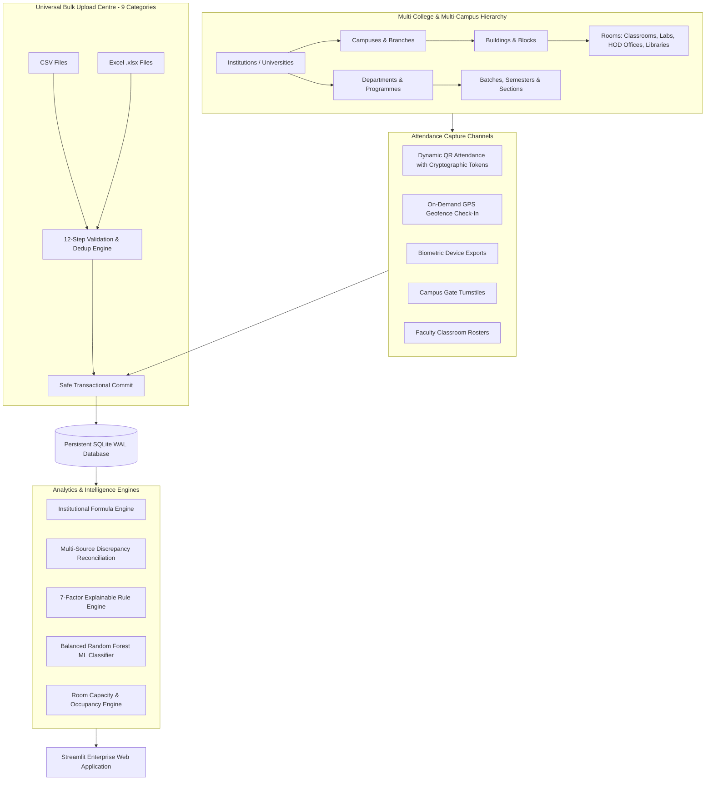

# Academic Attendance Pattern & Risk Analytics System (Enterprise Edition)

> **Multi-College & Multi-Campus Attendance Intelligence, Universal 9-Category CSV/XLSX Bulk Upload Centre, Campus Infrastructure & Room Capacity Oversight, Dynamic QR Attendance, Permission-Based GPS Check-In, Multi-Source Reconciliation, 7-Factor Explainable Risk Scoring, Holdout Machine Learning Evaluation & Hardware Vendor Adapters for Higher Education Institutions.**

---

## 📌 1. Project Overview & System Architecture

The **Academic Attendance Pattern & Risk Analytics System** is an enterprise-grade academic platform designed for universities, multi-campus colleges, and large educational institutions. It replaces hardcoded demonstration models with real, verified attendance records from authorized institutional sources, operating under strict tenant-level data isolation, role-based access control, and comprehensive audit standards.



---

## ⭐ 2. Core Functional Modules

### A. Multi-College & Multi-Campus Management
* **Tenant-Level Data Isolation:** Strict isolation between institutions (`institution_id`). Users from one college cannot view, modify, or query records from another institution.
* **Hierarchical Infrastructure:**
  * **Colleges & Universities:** Code, legal name, type, address, contact email.
  * **Campuses & Branches:** Campus code, city, GPS coordinates (latitude, longitude), geofence radius.
  * **Buildings & Blocks:** Multi-floor structures mapped to campuses.
  * **Rooms & Facilities:** Classrooms, Laboratories, Seminar Halls, Libraries, HOD Offices, Faculty Rooms with seating capacity, dimensions (sq. ft), and installed equipment.
  * **Departments & Programmes:** HOD profiles, email, allocated office rooms.
  * **Academic Batches:** Programme, academic year, semester, section.
* **Role-Based Access Control (RBAC):**
  * `Super Admin`: Cross-institutional oversight, tenant switching, global configuration.
  * `College Admin`: Institutional infrastructure, bulk upload, user rosters, policy rules.
  * `Campus Admin`: Campus-specific buildings, rooms, facilities, and local geofence settings.
  * `HOD / Dept Admin`: Department timetables, faculty assignments, reconciliation adjudication.
  * `Faculty / Instructor`: Class rosters, dynamic QR session generation, attendance review.
  * `Student`: Student 360 profile, personal attendance record, QR and GPS check-in portals.

---

### B. Universal Bulk Data Upload Centre (12-Step Ingestion Workflow)
Supports both **CSV** and **Excel (.xlsx)** across **9 institutional categories**:
1. **Colleges & Campuses**
2. **Buildings, Floors & Rooms**
3. **Departments, HODs & Faculty**
4. **Courses, Semesters, Batches & Sections**
5. **Students & Enrollment Information**
6. **Subjects & Faculty Allocations**
7. **Timetables & Classroom Allocations (with capacity check)**
8. **Attendance Records**
9. **Campus Geofence Coordinates**

#### 12-Step Validation & Commit Workflow:
1. **File Upload:** Drag-and-drop CSV or Excel (`.xlsx`, `.xls`) upload with file-size limits.
2. **Header Normalization:** Standardizes column names (trims spaces, handles case insensitivity and symbols).
3. **Downloadable Official Templates:** Ready-to-use CSV and Excel sample templates with pre-formatted columns.
4. **Interactive Record Preview:** Inspects top records before saving.
5. **Required Fields & Type Checking:** Validates non-empty primary keys, valid date formats (`YYYY-MM-DD`), numeric hours, and valid attendance statuses.
6. **Duplicate Detection:** Consolidates internal file duplicates on unique keys.
7. **Foreign Key Validation:** Verifies that referenced students, rooms, and subjects exist.
8. **Row-Level Error Reporting:** Row-by-row table highlighting exact row numbers, record IDs, violated fields, and actionable explanations.
9. **Status Summary Dashboard:** Real-time KPI counters for Total Rows, Valid Rows, Invalid Rows, Deduplicated Rows, and Staged Records.
10. **Error Report Download:** Export detailed row validation errors as JSON or CSV.
11. **Explicit Confirmation / Cancellation:** Users can discard staged batches or explicitly confirm database synchronization.
12. **Transactional Commit & Import History:** Saves records in a safe SQLite transaction (`BEGIN IMMEDIATE;`), writes immutable audit records, and logs import history.

---

### C. Campus Infrastructure & Room Capacity Management
* **Facility Inventory:** Complete oversight of classrooms, laboratories, seminar halls, and administrative offices.
* **Seating Capacity vs Timetable Strength Warnings:** Automatically cross-checks scheduled class expected strength against certified room capacity. Flags capacity breaches with deficit counts and warnings.
* **Check-In Occupancy Estimates:** Calculates real-time room occupancy rates by comparing attendance check-ins against room seating capacity.
* **Manual Facility Registration:** Allows authorized administrators to register or update room metadata directly from the UI.

---

### D. Dynamic QR Attendance System
* **No Hardware Required:** Zero requirement for physical RFID/biometric sensors.
* **Short-Lived Rotating Tokens:** Cryptographically hashed SHA-256 tokens expiring within a configurable window (30 to 600 seconds).
* **Live Classroom Projection Display:** Renders high-contrast QR codes for classroom projectors. Shows real-time countdown timer and active status.
* **Student Check-In Interface:** Mobile/web scanner client that validates student enrollment, token signature, and timetable session.
* **Duplicate Prevention:** Rejects repeated check-in attempts by the same student for the same class session.
* **Session Controls:** Instructors can open new attendance sessions and close running sessions at any time.

---

### E. Permission-Based GPS Campus Check-In
* **On-Demand Location Request:** Coordinates are captured strictly on-demand when the user clicks "Verify & Record Geofence Check-In". **No background tracking is performed.**
* **Haversine Geofence Calculation:** Computes great-circle distance between user coordinates and campus center in meters:
  $$\text{distance} = 2 \cdot R \cdot \arcsin\left(\sqrt{\sin^2\left(\frac{\Delta \text{lat}}{2}\right) + \cos(\text{lat}_1)\cos(\text{lat}_2)\sin^2\left(\frac{\Delta \text{lon}}{2}\right)}\right)$$
* **Boundary Enforcement:** Returns `VERIFIED_INSIDE` if within geofence radius; returns `DENIED_OUTSIDE_GEOFENCE` with excess distance if outside.
* **Administrative Review & Override:** Review portal with audit logging for manual approvals or transit delay exceptions.
* **Ethical Disclaimer:** Campus presence check-in confirms physical presence on campus premises and is not treated as proof of classroom attendance without session verification.

---

### F. Multi-Source Attendance Reconciliation
* **Cross-Source Corroboration:** Correlates timetable schedules, faculty registers, biometric punches, campus gate turnstiles, and QR check-ins.
* **Discrepancy Detection Rules:**
  1. `GATE_ENTRY_CLASSROOM_ABSENT`: Gate entry recorded, but student marked absent in class.
  2. `PRESENT_WITHOUT_DEVICE_CHECKIN`: Faculty marked present, but no sensor/QR check-in logged.
  3. `DUPLICATE_BIOMETRIC_PUNCH`: Rapid multiple biometric punches within 2 minutes.
  4. `UNRECORDED_LATE_ARRIVAL`: Check-in time exceeds timetable start plus grace tolerance.
* **Review Lifecycle:** Adjudication queue (`Pending` $\rightarrow$ `Verified` / `Corrected` / `Dismissed`) with reviewer notes.

---

### G. 7-Factor Explainable Risk Scoring & Holdout ML Evaluation
* **7-Factor Rule Scoring (0-100 Score):**
  1. Attendance Deficit vs Threshold (Max 30 pts)
  2. Recent 4-Week Trend Velocity (Max 20 pts)
  3. Consecutive Absence Streak Impact (Max 15 pts)
  4. Subject-Wise Vulnerability (Max 10 pts)
  5. Volatility & Variance (Max 10 pts)
  6. Class Benchmark Deficit (Max 5 pts)
  7. Recovery Difficulty Index (Max 10 pts)
* **Holdout Machine Learning Validation (Random Forest Classifier):**
  * Evaluated on a **75% training / 25% holdout test split**.
  * Class imbalance handled via `class_weight='balanced'`.
  * Genuine test-set metrics: **Precision, Recall, F1-Score, ROC-AUC, and Confusion Matrix**.
  * Feature attribution explaining top risk drivers without speculative claims.

---

### H. Hardware Vendor Integration Adapter Layer
* **Future-Proof Modularity:** Standard interface (`BaseAttendanceAdapter`) for future hardware additions.
* **Built-in Adapters:**
  * `CsvXlsxExportAdapter`: File-based batch synchronization.
  * `BiometricApiAdapter`: REST API connector for biometric door controllers (e.g. ZKTeco, Matrix, Essl).
  * `CampusGateApiAdapter`: REST API connector for pedestrian turnstiles and vehicle barriers.
* **Honest Offline Reporting:** Unconfigured devices honestly report `NOT_CONFIGURED` with status "Hardware integration pending". No simulated sensor data is fabricated.

---

## 🏗️ 3. Database Schema Overview

```sql
-- Institutions
CREATE TABLE institutions (
    institution_id TEXT PRIMARY KEY,
    institution_code TEXT UNIQUE NOT NULL,
    name TEXT NOT NULL,
    type TEXT DEFAULT 'College',
    address TEXT,
    contact_email TEXT,
    created_at TEXT NOT NULL
);

-- Campuses
CREATE TABLE campuses (
    campus_id TEXT PRIMARY KEY,
    institution_id TEXT NOT NULL,
    campus_code TEXT NOT NULL,
    name TEXT NOT NULL,
    city TEXT,
    latitude REAL DEFAULT 12.9716,
    longitude REAL DEFAULT 77.5946,
    geofence_radius_meters REAL DEFAULT 300.0,
    is_active INTEGER DEFAULT 1,
    FOREIGN KEY (institution_id) REFERENCES institutions(institution_id) ON DELETE CASCADE
);

-- Buildings
CREATE TABLE buildings (
    building_id TEXT PRIMARY KEY,
    campus_id TEXT NOT NULL,
    institution_id TEXT NOT NULL,
    building_name TEXT NOT NULL,
    building_code TEXT NOT NULL,
    total_floors INTEGER DEFAULT 4,
    FOREIGN KEY (campus_id) REFERENCES campuses(campus_id) ON DELETE CASCADE,
    FOREIGN KEY (institution_id) REFERENCES institutions(institution_id) ON DELETE CASCADE
);

-- Rooms (Classrooms, Labs, HOD Offices, Libraries)
CREATE TABLE rooms (
    room_id TEXT PRIMARY KEY,
    building_id TEXT NOT NULL,
    campus_id TEXT NOT NULL,
    institution_id TEXT NOT NULL,
    room_number TEXT NOT NULL,
    room_name TEXT NOT NULL,
    floor_number INTEGER DEFAULT 1,
    room_type TEXT NOT NULL,
    capacity INTEGER NOT NULL DEFAULT 60,
    dimension_sqft REAL DEFAULT 650.0,
    equipment_details TEXT,
    FOREIGN KEY (building_id) REFERENCES buildings(building_id) ON DELETE CASCADE,
    FOREIGN KEY (institution_id) REFERENCES institutions(institution_id) ON DELETE CASCADE
);

-- Timetable Sessions
CREATE TABLE timetable_sessions (
    session_id TEXT PRIMARY KEY,
    institution_id TEXT DEFAULT 'INST_001',
    campus_id TEXT DEFAULT 'CAMP_001',
    subject_id TEXT NOT NULL,
    room_id TEXT,
    day_of_week TEXT NOT NULL,
    period_number INTEGER NOT NULL,
    scheduled_start_time TEXT NOT NULL,
    scheduled_end_time TEXT NOT NULL,
    expected_strength INTEGER DEFAULT 60,
    FOREIGN KEY (subject_id) REFERENCES subjects(subject_id) ON DELETE CASCADE,
    FOREIGN KEY (room_id) REFERENCES rooms(room_id) ON DELETE SET NULL
);

-- Dynamic QR Sessions
CREATE TABLE qr_attendance_sessions (
    qr_session_id TEXT PRIMARY KEY,
    session_id TEXT NOT NULL,
    institution_id TEXT NOT NULL,
    subject_id TEXT NOT NULL,
    room_id TEXT,
    token_hash TEXT NOT NULL,
    opened_by TEXT NOT NULL,
    opened_at TEXT NOT NULL,
    expires_at TEXT NOT NULL,
    is_active INTEGER DEFAULT 1,
    FOREIGN KEY (session_id) REFERENCES timetable_sessions(session_id) ON DELETE CASCADE
);

-- GPS Geofence Check-In Logs
CREATE TABLE gps_checkin_logs (
    checkin_id TEXT PRIMARY KEY,
    institution_id TEXT NOT NULL,
    campus_id TEXT NOT NULL,
    user_id TEXT NOT NULL,
    latitude REAL NOT NULL,
    longitude REAL NOT NULL,
    distance_from_center_meters REAL NOT NULL,
    verification_status TEXT NOT NULL,
    device_info TEXT,
    timestamp TEXT NOT NULL,
    reviewed_by TEXT,
    review_status TEXT DEFAULT 'Auto-Verified'
);

-- Attendance Records
CREATE TABLE attendance (
    attendance_id INTEGER PRIMARY KEY AUTOINCREMENT,
    institution_id TEXT DEFAULT 'INST_001',
    campus_id TEXT DEFAULT 'CAMP_001',
    student_id TEXT NOT NULL,
    subject_id TEXT NOT NULL,
    date TEXT NOT NULL,
    status TEXT NOT NULL,
    hour INTEGER NOT NULL,
    week INTEGER NOT NULL,
    room_id TEXT,
    verification_method TEXT DEFAULT 'FILE_IMPORT',
    scheduled_start_time TEXT,
    scheduled_end_time TEXT,
    check_in_time TEXT,
    check_out_time TEXT,
    source_system TEXT DEFAULT 'CSV_IMPORT',
    session_id TEXT,
    record_created_at TEXT,
    is_manually_corrected INTEGER DEFAULT 0,
    FOREIGN KEY (student_id) REFERENCES students(student_id) ON DELETE CASCADE,
    FOREIGN KEY (subject_id) REFERENCES subjects(subject_id) ON DELETE CASCADE
);

-- Import History
CREATE TABLE import_history (
    import_id TEXT PRIMARY KEY,
    institution_id TEXT NOT NULL,
    data_category TEXT NOT NULL,
    file_name TEXT NOT NULL,
    total_rows INTEGER NOT NULL,
    valid_rows INTEGER NOT NULL,
    invalid_rows INTEGER NOT NULL,
    duplicate_rows INTEGER NOT NULL,
    status TEXT NOT NULL,
    performed_by TEXT NOT NULL,
    timestamp TEXT NOT NULL,
    error_report_json TEXT
);
```

---

## 🚀 4. Installation & Quick Start

### Prerequisites
- Python 3.10, 3.11, or 3.12
- Windows, macOS, or Linux

### Installation
```bash
# Clone or navigate to the project directory
cd project1

# Install required dependencies
pip install -r requirements.txt
```

### Running the Application
The application can be launched from either the workspace root or the project folder:
```bash
# From workspace root
streamlit run app.py

# Or from project1 directory
cd project1
streamlit run app.py
```
Open your browser to: **`http://localhost:8501`**

---

## 🧪 5. Automated Test Suite (15 Test Cases)

To execute the automated test suite against an isolated temporary SQLite database:
```bash
python test_suite.py
```

### Verified Test Cases:
| Test ID | Test Name | Description | Result |
|---|---|---|---|
| `test_01` | `database_schema_and_integrity` | Schema tables, WAL mode, foreign keys, settings | `PASSED` |
| `test_02` | `institutional_attendance_formula` | Eligibility calculation, cancelled sessions, excused leaves | `PASSED` |
| `test_03` | `csv_and_excel_file_ingestion` | File parsing, column normalization, row validation | `PASSED` |
| `test_04` | `duplicate_detection_and_conflict_handling` | In-file deduplication and non-destructive conflict handling | `PASSED` |
| `test_05` | `threshold_boundaries_and_benchmarks` | Statutory 75% cutoff, warning buffer, department benchmarks | `PASSED` |
| `test_06` | `multi_source_reconciliation_engine` | Multi-source discrepancy correlation, confidence score, review | `PASSED` |
| `test_07` | `machine_learning_risk_evaluation` | 75/25 holdout evaluation, balanced RandomForest, genuine metrics | `PASSED` |
| `test_08` | `manual_correction_audit_trail` | Attendance status override with immutable audit trail | `PASSED` |
| `test_09` | `vendor_adapters_connectivity` | Adapter interfaces and honest offline reporting | `PASSED` |
| `test_10` | `reports_export_formats` | PDF, CSV, and class summary report generation | `PASSED` |
| `test_11` | `multi_tenant_data_isolation` | Tenant isolation between independent institutions (Alpha vs Beta) | `PASSED` |
| `test_12` | `universal_bulk_importer_and_validation` | 9-category template generation (CSV/XLSX), 12-step validation | `PASSED` |
| `test_13` | `campus_infrastructure_and_capacity_breach` | Room creation, timetable capacity breach detection, occupancy | `PASSED` |
| `test_14` | `dynamic_qr_attendance_lifecycle` | Rotating QR tokens, check-in validation, duplicate rejection | `PASSED` |
| `test_15` | `gps_campus_geofence_haversine` | Haversine formula, inside geofence, outside denial, override | `PASSED` |

---

## 📁 6. Project File Structure

```
project1/
├── app.py                          # Master entry point and navigation controller
├── requirements.txt                # Dependencies (Streamlit, Pandas, Scikit-Learn, openpyxl, qrcode, etc.)
├── test_suite.py                   # 15 automated test cases with isolated test database
├── README.md                       # Comprehensive documentation
├── analytics/                      # Analytics and ML Intelligence Engines
│   ├── attendance.py               # Institutional formula, eligibility, trends, benchmarks
│   ├── gps_engine.py               # Haversine distance, boundary evaluation, check-in execution
│   ├── ml_risk_model.py            # Balanced RandomForest holdout evaluation (75/25 split)
│   ├── pattern_detection.py        # DOW analysis, streak tracking, post-holiday patterns
│   ├── qr_engine.py                # Cryptographic QR tokens, PNG rendering, session control
│   ├── reconciliation.py           # Multi-source discrepancy matching, evidence inspection
│   ├── recovery_simulator.py       # Mathematical recovery roadmap and what-if simulation
│   └── risk_engine.py              # 7-factor explainable rule-based scoring engine
├── database/                       # Database Architecture & Persistence
│   ├── database.py                 # SQLite WAL management, multi-tenant queries, audit logs
│   └── attendance.db               # Production SQLite database (clean, zero hardcoded records)
├── integrations/                   # Vendor Integration Adapters
│   └── vendor_adapters.py          # Extensible adapter classes (CSV, Biometric API, Campus Gate API)
├── reports/                        # Report Generation
│   └── report_generator.py         # PDF and CSV report builders
├── utils/                          # Utilities & Ingestion Hub
│   ├── auth_context.py             # Tenant session state, RBAC role switcher & permissions
│   ├── helpers.py                  # Theme styling, KPI cards, alerts, empty states
│   ├── importer.py                 # Universal 9-category bulk ingestion engine (CSV / XLSX)
│   └── preprocessing.py            # Header normalization & legacy format support
└── views/                          # Streamlit UI Views
    ├── dashboard_view.py           # Executive dashboard with infrastructure KPIs & warnings
    ├── infrastructure_view.py      # Campus infrastructure, room capacity & occupancy view
    ├── qr_attendance_view.py       # Dynamic QR session controller & student check-in portal
    ├── gps_checkin_view.py         # GPS boundary check-in & administrative review portal
    ├── upload_view.py              # Universal Bulk Data Upload Centre & audit ledger
    ├── reconciliation_view.py      # Multi-source discrepancy review queue
    ├── student_analysis_view.py    # Student 360 profile & behavioral breakdown
    ├── risk_analytics_view.py      # 7-factor explainable risk analysis & ML metrics
    ├── early_warning_view.py       # Trajectory forecasting & statutory threshold alerts
    ├── recovery_view.py            # Mathematical recovery simulator
    ├── patterns_view.py            # Behavioral absence pattern diagnostics
    ├── subjects_view.py            # Course & subject performance intelligence
    ├── alerts_view.py              # Escalation center & intervention action tracking
    ├── integrations_view.py        # Hardware adapter configuration & connection diagnostics
    ├── reports_view.py             # PDF & CSV reporting center
    └── settings_view.py            # Institutional rules, thresholds & audit trail
```
